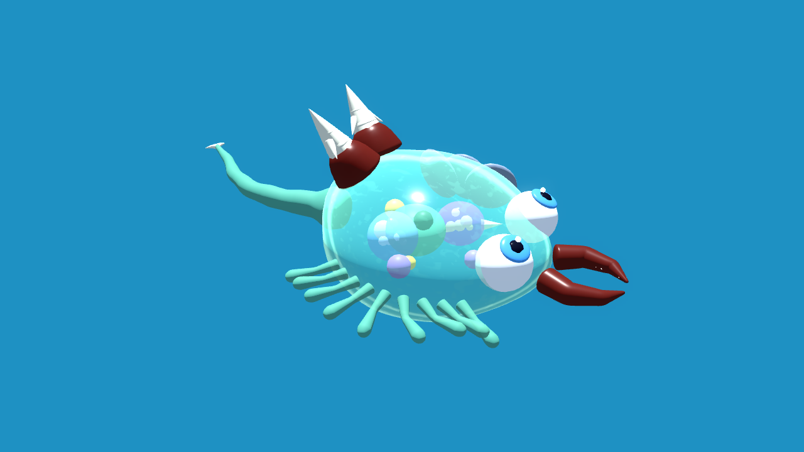
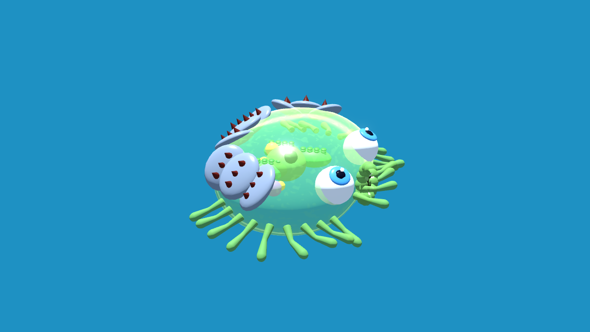
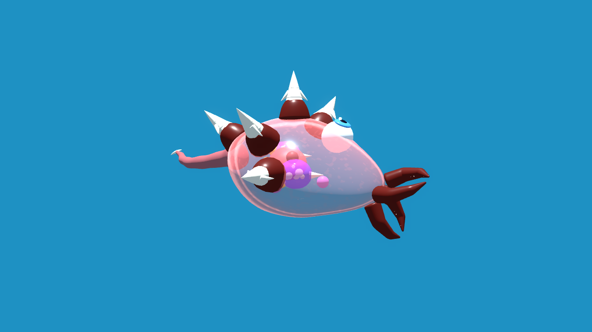
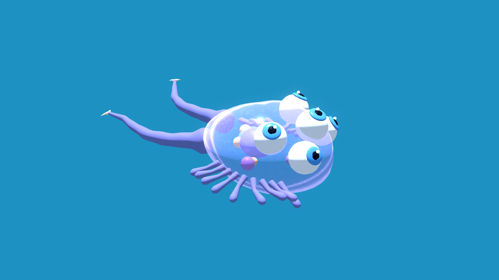
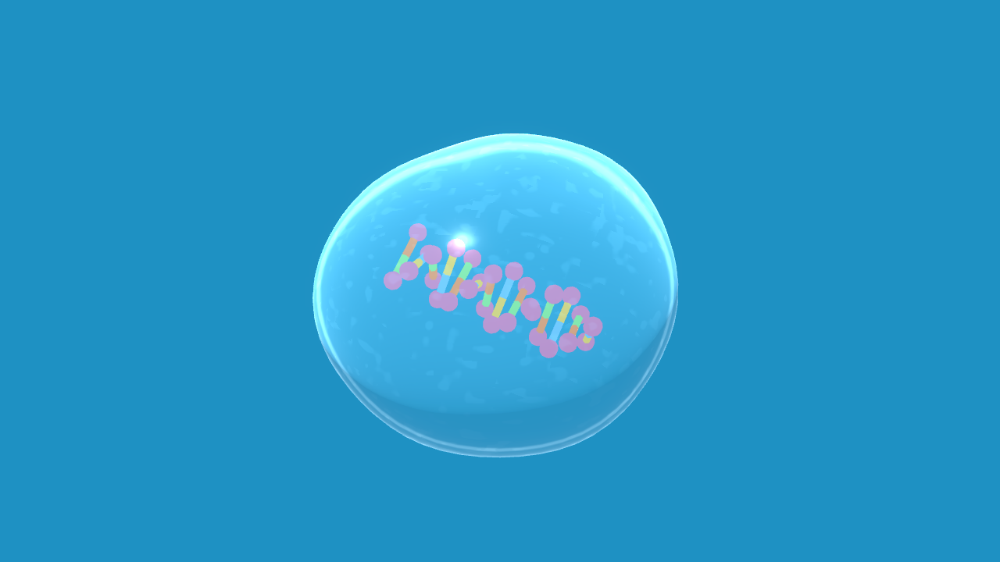
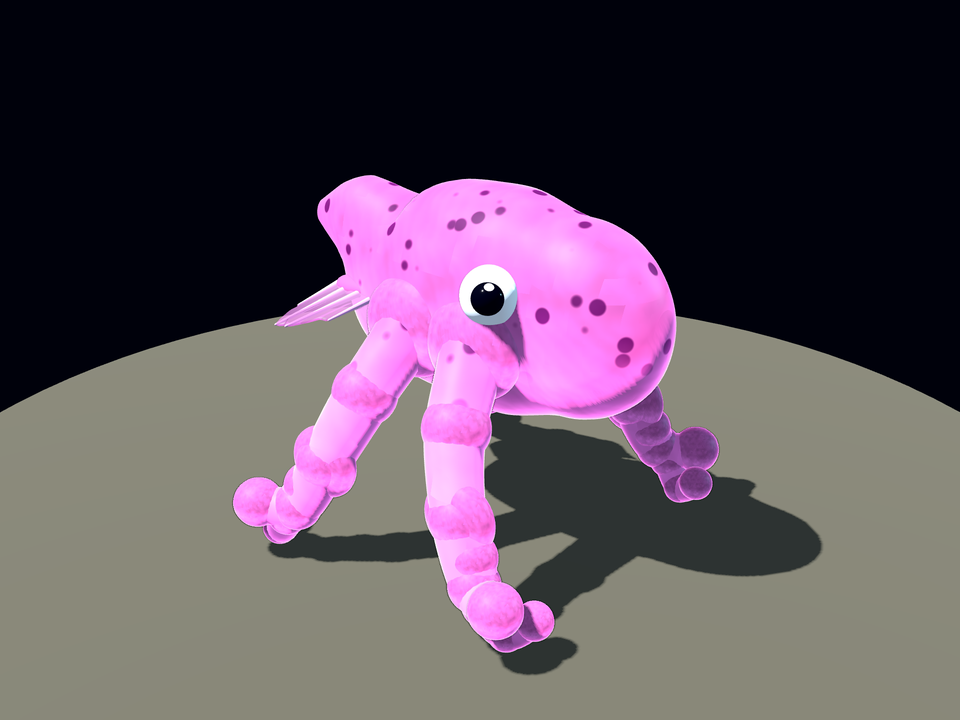
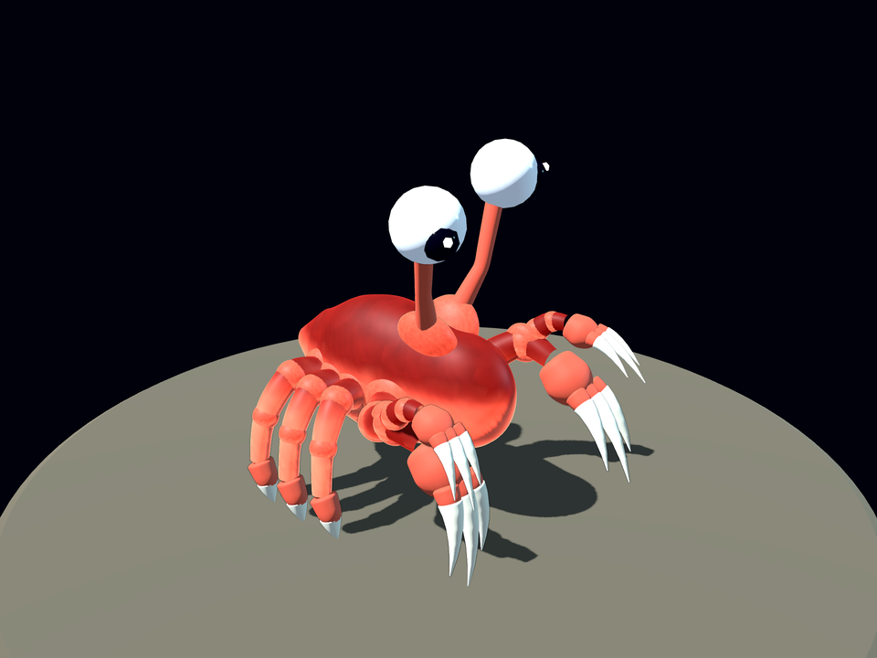
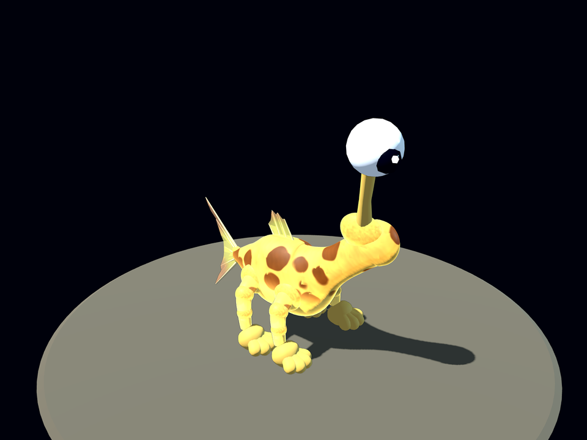
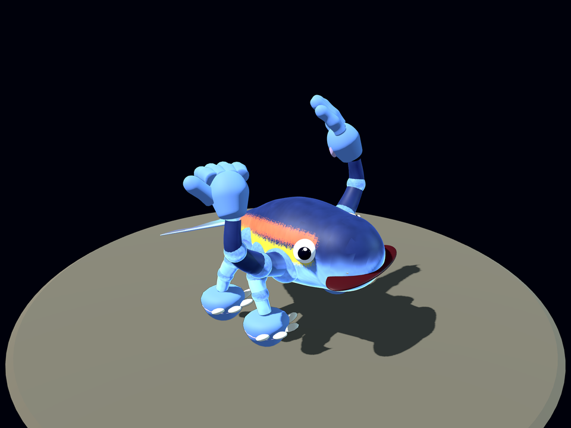

# 🦠 Cell Out

*Inspired by Spore. 🌱👾*

> [!WARNING]
> **⚠️🤖 WARNING: THIS IS AN AI SLOP GAME 🤖⚠️**
>
> This game was 99% splattered together by an AI. The remaining 1% is the human who said "make it more fun" 47 times. 🔁
>
> Just like the primordial soup your cell swims in, this code **emerged spontaneously, is chaotic and probably not viable**. Bugs aren't errors, they're **mutations**. 🧬 They're part of evolution.
>
> Play at your own risk. For risks and side effects, consult your prompt or your GPU. 🔥🖥️

> [!CAUTION]
> **🚧 EARLY ALPHA 🚧**
>
> Work in progress: features are incomplete, balancing is rough, there is no saving yet, and stages and controls can change or break at any time. 🧪

> From primordial soup to multicellular life. An evolution game in Godot 4 (C#), realistically inspired, cartoony in 3D.

<p align="center"></p>

You start as a **protocell**, a lipid bubble with a floating DNA helix, collecting biomolecules. As you grow you develop a nucleus, eat smaller cells and mutate. Once you are big enough you **divide**: every cell splits, 1 → 2 → 4 → … → 64 cells stick together as one growing cluster.

## 📸 Gallery

| | |
|---|---|
|  |  |
| 🌿 **Herbivore**: chloroplasts, filter mouth, armour plates, cilia | 🩸 **Predator**: double jaws, spike crown, venom vacuoles |
|  |  |
| 🔭 **Scout**: five eyes, two flagella, cilia | 🧬 **Protocell**: a lipid bubble with a DNA helix |

Every part is placed freely on the membrane in the cell editor (around, on top, underneath), and the cell itself can be stretched and raised into any shape.

## 🐾 Creature gallery

Shaped in the creature editor: bend and stretch the spine, pull limbs out by their joints, branch them, stick feet and hands on the tips, paint patterns and spray your own. Results may vary. 🧪

| | |
|:---:|:---:|
|  |  |
| **Squid** 🦑<br>Four tentacles that fork into eight, eyes the size of its worries. | **Crab** 🦀<br>Six pointy crab feet for sideways sprints, two claws per arm because one is never enough. |
|  |  |
| **Giraffe sausage** 🦒🌭<br>A neck pulled up for the high plankton, paws for the beach, one very curious stalk eye. | **Muscle whale** 💪🐳<br>Never skips arm day. Big brain, bigger grin, sprayed-on racing stripes. |

## ▶️ Getting started

1. Install [Godot 4.7 **.NET**](https://godotengine.org/download) and the [.NET SDK 8+](https://dotnet.microsoft.com/download)
2. In Godot: **Import** → select `project.godot` in this folder
3. Press **F5** (builds the C# project automatically)

Without the editor: `dotnet build`, then `godot --path .` with the .NET binary.

## 🎮 Controls

| Action | Key |
|---|---|
| Swim | `WASD` / arrow keys / hold left mouse button |
| Zoom | Mouse wheel |
| Cell editor (on every level-up) | Pick a part on the left, left click places, right click removes |
| Language DE/EN | Button top right (starts with the system language) |

Smaller cells you touch get engulfed and digested, bigger ones engulf you. Swim away before your health runs out: at zero it's **game over**.

**Diet bar** (top right): molecules and photosynthesis pull to the left (herbivore), eaten cells to the right (carnivore), editor parts in their own direction. The position unlocks parts: armour plate on the left, cilia in the middle, jaws and venom vacuole on the right.

## 🧬 Stages

| Stage | From biomass | What changes |
|---|---|---|
| Protocell | 0 | Only absorb molecules (sugars, amino acids, lipids), no nucleus |
| Single cell | 40 | Nucleus, eat smaller cells, cell editor: place parts freely on the membrane (position matters) |
| Multicellular | first division | From 100 biomass you may divide (Space or the button), every cell splits and the cluster keeps its size. Each further division needs 2.5× the biomass, up to 64 cells. Every cell carries your editor design. Perks: a deadly hit only bursts a quarter of the cells, and each division lets you swallow 5% bigger prey |

Enemies and food scale with your size and the camera zooms out with you. That way the world gets "bigger" as you do.

## 🗂️ Structure

```
project.godot / CellOut.csproj               # Godot 4.7 .NET, C# (net8.0)
scenes/main.tscn                             # Entry scene, root script Game/Main.cs
scripts/                                     # By era first, domain second
  Core/    Plane3D, Rand, Ease, Log,         # 2D↔3D bridge, randomness, easing,
           PartModels, TreeModels            # verbose log, model loaders
  Game/    Main, Player, Food, Backdrop,     # Game loop, player, food, scenery,
           Cutscenes/, Ui/                   # cutscenes, HUD and menus
  Prelude/ RnaWorld, Mutation                # Playable RNA world
  Cell/    CellBody, CellVisual3D, Critter,  # Protocell to multicellular,
           PartCatalog, CellDesign, Editor/  # cell parts, cell editor
  Creature/ CreatureDesign, Coast, Editor/   # Organism to land animal, creature editor
shaders/   membrane, ocean, greyout,         # Cell membrane, ocean floor,
           editor_panel                      # editor grey-out and panel
locale/    translations.csv                  # All UI texts, German + English
fonts/     CellOut, CellOutDisplay           # Own game fonts: text + titles (generated)
tests/     SmokeTest                         # Headless run through all stages
tools/     Test-CellOut.ps1                  # Build + import + smoke test
           font/                             # Node generator of the game font
```

No external assets: game logic in 2D, rendering in real 3D, everything procedural from primitives and shaders. Even the fonts are generated (`tools/font`, `npm run build`): a readable text font with wobbling membrane strokes and organelle-bubble dots, and a display font for titles with fat cytoplasm strokes full of vacuoles, nuclei in the bowls and bouncing letters.

## 🚀 Roadmap

- [ ] Stage 4: Organism (body plan, organs instead of single cells)
- [ ] Environment zones (deep sea, hydrothermal vent, light zone with photosynthesis bonus)
- [ ] Sound & music
- [ ] Save / load
- [ ] Mutations with visible trade-offs (e.g. armour = slower)
- [ ] GitHub Action: smoke test + Godot export for Windows (web export doesn't work with C#)
